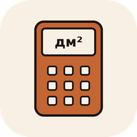
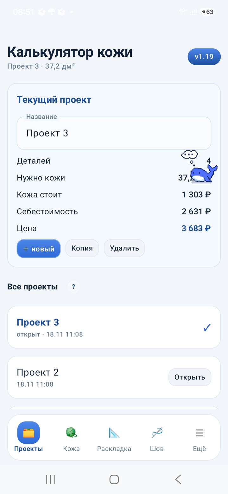

<p align="center">
  
</p>

# Leather Calculator — калькулятор и учебник для кожевников

Android-приложение: считает расход кожи, стоимость материала и работы, помогает с раскладкой,
шаблонами изделий и учит кожевенному делу. Полностью офлайн, данные остаются на телефоне.

## Что умеет

- **Расчёт кожи**: детали с коэффициентами раскроя (1,15–1,5), полезный выход шкуры,
  число шкур, остаток, цена полезного дм².
- **Деньги**: фурнитура (каталог с ценами), расходники, часы × ставка, брак, накладные,
  наценка, себестоимость и цена; таймер работы.
- **Шаблоны**: 16 готовых изделий + свои шаблоны из текущего проекта.
- **Параметрические модели**: сумка с клапаном, шоппер, косметичка, ремень, ножны —
  детали пересчитываются по габаритам.
- **Фото → детали**: распознавание размеров с фото выкройки (ML Kit), ручная правка.
- **Мастер проекта**: 4 шага от изделия к смете.
- **Раскладка**: автораскладка, перетаскивание деталей и дефектов, заполнение листа.
- **Экспорт**: PDF-смета, печать деталей 1:1 (A4 с контрольным квадратом), SVG, DXF.
- **Замер шкуры по фото**: контур + эталонный отрезок → площадь в дм².
- **Склад**, **бэкап/импорт JSON**, **CSV-экспорт**, **виджет**, тёмная тема,
  русский и английский интерфейс, отдельный язык документов.

## Сборка

Нужны JDK 21, Android SDK (platform 35, build-tools 35.0.0), Gradle 8.13.

```bash
export ANDROID_HOME=/path/to/android-sdk
./gradlew assembleDebug          # debug APK
./gradlew testDebugUnitTest      # 37 юнит-тестов
./gradlew assembleRelease        # release (нужен свой keystore)
```

Подпись release настраивается через `~/.gradle/gradle.properties` или переменные окружения:
`leatherKeystore`, `leatherStorePassword`, `leatherKeyAlias`, `leatherKeyPassword`
(или `LEATHER_KEYSTORE`, `LEATHER_STORE_PASSWORD`, `LEATHER_KEY_ALIAS`, `LEATHER_KEY_PASSWORD`).
В репозитории ключей и паролей нет.

Особенность: на aarch64 (сборка прямо на телефоне) Google-овский aapt2 не запускается.
Используется arm64-сборка aapt2 из Termux и обёртка, подключаемая через
`android.aapt2FromMavenOverride` — подробности в `docs/FEATURES.md`.

## Скриншоты

| Проекты |
|---|
|  |

Остальные экраны добавляются скриптом `scripts/import-screenshots.py`: он распознаёт
снимки из галереи, определяет экран по тексту и сжимает их. Подробности — `docs/SCREENSHOTS.md`.

## CI

GitHub Actions собирает APK на каждый пуш и релиз по тегу — см. `docs/CI.md`.

## Структура

```
app/src/main/java/ru/leather/calc/
  CalcState.kt      состояние, расчёты, проекты, сохранение (дебаунс)
  Templates.kt      16 шаблонов + свои
  ParamModels.kt    параметрические модели
  Wizard.kt         мастер проекта, изометрический эскиз
  Screen*.kt        экраны (кожа, раскладка, склад, учебник, справка, шов, деньги, настройки)
  SheetParser.kt    разбор размеров с фото
  PdfEstimate.kt / PdfPieces.kt / SvgExport.kt / DxfExport.kt  — экспорт
  AreaMath.kt       геометрия замера шкуры
```

## Лицензия

MIT — см. `LICENSE`. Иллюстрации в уроках: свободные фото CC BY 2.0 (Ivan Radic,
Mirøslav Hristøff, Ralf Steinberger) и собственные схемы.
